# Docker 使用手册

## 目录

- [1. Docker 简介](#1-docker-简介)
- [2. 安装与卸载](#2-安装与卸载)
- [3. 快速开始](#3-快速开始)
- [4. 常用命令](#4-常用命令)
- [5. 镜像管理](#5-镜像管理)
- [6. 私有仓库](#6-私有仓库)
- [7. Dockerfile 构建应用镜像](#7-dockerfile-构建应用镜像)
- [8. Docker Compose](#8-docker-compose)
- [9. 容器网络](#9-容器网络)
- [10. 容器运维](#10-容器运维)
- [11. 安全与远程访问](#11-安全与远程访问)
- [12. 可视化管理工具](#12-可视化管理工具)
- [13. Docker Swarm](#13-docker-swarm)
- [14. 自动更新镜像 — Watchtower](#14-自动更新镜像--watchtower)
- [15. 问题排查与常见问题](#15-问题排查与常见问题)
- [16. Docker Desktop](#16-docker-desktop)

***

## 1. Docker 简介

Docker 是一个开源的应用容器引擎，让开发者可以打包他们的应用以及依赖包到一个可移植的镜像中，然后发布到任何流行的 Linux 或 Windows 操作系统的机器上，也可以实现虚拟化。容器是完全使用沙箱机制，相互之间不会有任何接口。

> ex:
> 前端 Vue 需要 build 打包在 nginx 环境部署；
> 后端 Java 需要 `java -jar app.jar` 运行；
> 前后端需要安装不同的环境去部署运行。
> 这个时候我们可以通过 docker 容器统一的环境去一键运行发布这些应用 `docker run ...`。

### 三个基本概念

1. **镜像（Image）**：一个特殊文件系统。ex: ubuntu 系统。
2. **容器（Container）**：镜像运行时的实体。容器可以被创建、启动、停止、删除等。
3. **仓库（Repository）**：保存镜像。ex: <https://hub.docker.com>
   - public（共有仓库）：免费上传、下载公开的镜像。
   - private（私有仓库）：需要认证才能上传、下载镜像。

Docker 使用客户端-服务器（C/S）架构模式，使用远程 API 来管理和创建 Docker 容器。

### 架构

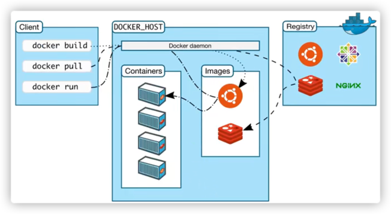

***

## 2. 安装与卸载

### 2.1 Docker 安装

> 可参考 <https://docs.docker.com/engine/install/centos>
>
> 已测可行环境：
>
> - CentOS Linux release 7.6.1810 (Core)
> - CentOS Linux release 8.4.2105 (Core)
> - TencentOS Server release 3.1 (Final)
> - CentOS Stream release 8

```shell
# 查看CentOS系统版本
cat /etc/redhat-release

# 配置yum源
sudo yum install -y yum-utils
sudo yum-config-manager \
    --add-repo \
    http://mirrors.aliyun.com/docker-ce/linux/centos/docker-ce.repo

# 通过yum源安装docker（指定版本安装）
sudo yum install -y docker-ce-20.10.7 docker-ce-cli-20.10.7 containerd.io-1.4.6

# 设置开机自启 & 现在启动
sudo systemctl enable --now docker

# 测试
docker run --rm alpine ping -c 5 baidu.com
```

#### 配置镜像加速器

```shell
sudo mkdir -p /etc/docker
sudo tee /etc/docker/daemon.json <<-'EOF'
{
  "registry-mirrors": ["加速器地址"]
}
EOF
sudo systemctl daemon-reload
sudo systemctl restart docker
docker info   # 查看 Registry Mirrors
```

### 2.2 docker-compose 安装

```shell
sudo yum -y install epel-release
sudo yum install -y python36-pip
sudo pip3 install --upgrade pip
sudo pip3 install -U docker-compose
docker-compose --version
```

### 2.3 常用 shell 组合

```shell
# 删除所有容器
docker stop `docker ps -q -a` | xargs docker rm
# 删除所有标签为none的镜像
docker images|grep \<none\>|awk '{print $3}'|xargs docker rmi
# 查找容器IP地址
docker inspect 容器名或ID | grep "IPAddress"
# 创建网段, 名称: mynet, 分配两个容器在同一网段中
docker network create mynet
docker run -d --net mynet --name container1 my_image
docker run -it --net mynet --name container2 another_image
```

### 2.4 卸载

#### Docker 卸载

```shell
yum list installed |grep docker
yum -y remove docker* containerd.io
rm -rf /var/lib/docker
rm -rf /var/lib/containerd
```

#### docker-compose 卸载

```shell
pip3 uninstall docker-compose
```

***

## 3. 快速开始

### 3.1 运行 Nginx

```shell
docker pull nginx

# --name 定义容器名
# -d 后台运行
# -p 端口映射：宿主机端口:容器端口
docker run --name nginx -d -p 8080:80 nginx
```

访问 <http://127.0.0.1:8080>

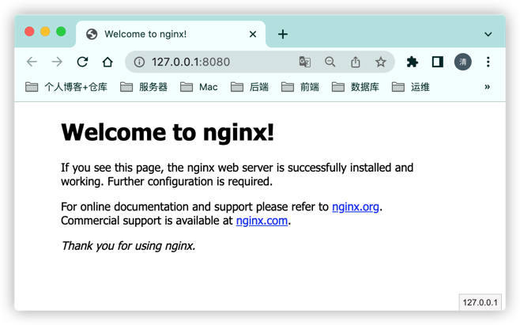

### 3.2 运行 Java 项目

```shell
docker pull java:latest
```

```shell
# 1、原生jar运行方式
java -jar xx.jar --spring.profiles.active=prod

# 2、java镜像环境运行方式
docker run -d -p 3001:3001 --restart=always -v /zhengqingya/code/demo/app.jar:/tmp/app.jar --name springboot java:latest java -jar /tmp/app.jar

# 3、可远程调试运行方式
docker run -d -p 5000:5000 -p 50001:50001 --name demo \
-v /zhengqingya/code/demo/app.jar:/tmp/app.jar \
java:latest \
java -agentlib:jdwp=transport=dt_socket,server=y,suspend=n,address=50001 -jar /tmp/app.jar --spring.profiles.active=prod

# 4、从镜像仓库拉取运行方式
docker run -d -p 5000:5000 -p 50001:50001 \
-e PROFILE=prod \
--restart always \
--name demo \
registry.cn-hangzhou.aliyuncs.com/zhengqing/demo
```

#### arthas 相关

```shell
docker exec -it demo /bin/sh -c "wget https://alibaba.github.io/arthas/arthas-boot.jar && java -jar arthas-boot.jar"
docker exec -it demo /bin/sh -c "java -jar /opt/arthas/arthas-boot.jar"
```

***

## 4. 常用命令

### 4.1 基本

```shell
docker -v
docker version
docker info
```

### 4.2 开发常用

```shell
# 列出容器 -- 仅运行的容器
docker ps
# 列出容器 -- 包含停止的容器
docker ps -a

# 查看当前本地所有镜像
docker images

# 搜索镜像
docker search 镜像
# 获取镜像
docker pull 镜像仓库地址
# 上传镜像
docker push 镜像仓库地址

# 运行容器 (-m 限制内存100m)
docker run --name nginx -d -p 8080:80 -m 100m nginx

# 停止/启动/重启容器
docker stop 容器ID/容器名
docker start 容器ID/容器名
docker restart 容器ID/容器名

# 杀掉运行中的容器
docker kill -s KILL 容器ID/容器名

# 删除容器
docker rm 容器ID/容器名
docker rm -f xx、xx2

# 删除镜像 【顺序：停止容器 → 删除容器 → 删除镜像】
docker rmi 镜像id/镜像名

# 进入容器
docker exec -it 容器ID/容器名 /bin/bash
exit  # 退出

# 交互模式启动
docker run -i -t 容器ID/容器名 /bin/bash

# 查看容器日志 -t:显示时间戳
docker logs -f -t 容器ID/容器名
docker logs -fn10 -t 容器ID/容器名

# 构造镜像
docker build -t docker_demo .
```

### 4.3 容器信息

```shell
# 查看容器/镜像元数据
docker inspect 容器ID/容器名
# 查询容器内部ip地址
docker inspect 容器ID/容器名 | grep IPAddress
# 查看日志文件路径
docker inspect --format='{{.LogPath}}' 容器ID/容器名
# 查看容器在 /var/lib/docker/overlay2/ 下的数据目录
docker inspect -f '{{ .GraphDriver.Data.MergedDir }}' 容器ID/容器名
# 查看容器映射的数据存放目录
docker inspect -f '{{ .Mounts }}' 容器ID/容器名
```

### 4.4 运维常用

```shell
# 列出所有的容器 ID
docker ps -aq
# 停止/删除所有的容器
docker stop $(docker ps -aq)
docker rm $(docker ps -aq)
# 删除所有的镜像
docker rmi $(docker images -q)

# 停止并删除指定容器
docker ps -a | grep 容器ID/容器名 | awk '{print $1}' | xargs -i docker stop {} | xargs -i docker rm {}

# 删除指定镜像
docker images | grep -E "镜像id/镜像名" | awk '{print $3}' | uniq | xargs -I {} docker rmi --force {}
# ex: 删除镜像 nginx:latest
docker images | grep -E nginx | grep latest| awk '{print $3}' | uniq | xargs -I {} docker rmi --force {}

# 删除所有停止的容器
docker container prune
# 删除所有不使用的镜像
docker image prune --force --all

# 查看容器运行内存信息
docker stats nginx
```

### 4.5 其它

```shell
# 查看镜像的创建历史
docker history 镜像仓库地址
```

***

## 5. 镜像管理

### 5.1 基于容器创建新镜像

```shell
# -a :提交的镜像作者
# -c :使用Dockerfile指令来创建镜像
# -m :提交时的说明文字
# -p :在commit时，将容器暂停
docker commit -m "描述信息" -a "作者" 容器名 新的镜像
docker push 新的镜像
```

#### ex: 提交 centos

```shell
docker pull centos:6.6
docker run -i -t --name=centos centos:6.6 bash
mkdir -p /zhengqingya/soft
echo '测试' > test.txt
exit

# 检查容器里文件结构的更改
docker diff centos容器ID/容器名

# 提交镜像
docker commit -m "测试提交" -a "zhengqingya" centos容器ID registry.cn-hangzhou.aliyuncs.com/zhengqing/centos:latest
docker push registry.cn-hangzhou.aliyuncs.com/zhengqing/centos:latest

# 拉取运行
docker run -i -t --name=mycentos registry.cn-hangzhou.aliyuncs.com/zhengqing/centos:latest bash
```

#### ex: 提交 redis / jenkins

```shell
# redis
docker run --name redis_server -p 6379:6379 -d redis:latest redis-server
docker diff centos镜像id
docker commit -m "测试提交" -a "zhengqingya" centos镜像id registry.cn-hangzhou.aliyuncs.com/zhengqing/redis_test:latest
docker push registry.cn-hangzhou.aliyuncs.com/zhengqing/redis_test:latest

# jenkins
docker diff jenkins
docker commit -m "测试提交jenkins" -a "zhengqingya" jenkins registry.cn-hangzhou.aliyuncs.com/zhengqing/jenkins:v1
docker push registry.cn-hangzhou.aliyuncs.com/zhengqing/jenkins:v1
docker run -d --name jenkins_test -p 10000:8080 -u root registry.cn-hangzhou.aliyuncs.com/zhengqing/jenkins:v1
```

### 5.2 导入导出镜像

```shell
# 准备一个修改过的镜像
docker pull nginx
docker run --name nginx -d -p 8080:80 nginx
docker exec -it nginx /bin/bash
echo '<h1>Hello World</h1>' > /usr/share/nginx/html/index.html
docker commit -m "This is my nginx image" -a "zhengqingya" nginx my-nginx:v1

# 导出镜像
docker save -o my-nginx.tar my-nginx:v1

# 导入镜像
docker rm -f nginx
docker rmi my-nginx:v1
docker load -i my-nginx.tar
docker run --name nginx -d -p 8080:80 my-nginx:v1
```

### 5.3 镜像推送

```shell
# 登录认证仓库
docker login -u 用户名 -p 密码 仓库地址
# 拉取镜像
docker pull 镜像仓库地址
# 重命名镜像
docker tag 镜像名 新镜像仓库地址
# 推送镜像
docker push 新镜像仓库地址
```

举例：

```shell
docker login -u admin -p Harbor12345 harbor.zhengqingya.com:11000
docker pull nginx
docker tag nginx harbor.zhengqingya.com:11000/zhengqing/nginx:latest
docker push harbor.zhengqingya.com:11000/zhengqing/nginx:latest
```

***

## 6. 私有仓库

### 6.1 认证私有仓库

```shell
# 认证
docker login -u 用户名 -p 密码 私有仓库地址
# ex: 认证harbor私服
docker login -u admin -p Harbor12345 harbor.zhengqingya.com:11000

# 移除认证
docker logout 私有仓库地址
```

### 6.2 查看密码

`config.json` 会记录登录之后的用户名和密码（base64 加密）。

```shell
cat ~/.docker/config.json
# {
#     "auths": {
#         "harbor.zhengqingya.com:11000": {
#             "auth": "YWRtaW46SGFyYm9yMTIzNDU="
#         }
#     }
# }

# 解密
echo 'YWRtaW46SGFyYm9yMTIzNDU=' | base64 --decode
# username:password
```

### 6.3 密码安全 — 使用 pass 保护仓库登录凭证

Docker 提供 `credentials store`，可以将用户凭证保存在外部凭证存储中（而非明文 base64）。

参考：<https://docs.docker.com/engine/reference/commandline/login/#credentials-store>

```shell
# 安装密码仓库
yum install -y gpg pass rng-tools
# pass需源码安装
curl -o password-store1.7.3.tar.xz https://git.zx2c4.com/password-store/snapshot/password-store1.7.3.tar.xz
tar Jxf password-store1.7.3.tar.xz
cd password-store1.7.3 && make install

# 使用GPG生成KEY
rngd -r /dev/urandom
gpg --gen-key   # 设置密码 ☆☆☆
gpg --list-keys
pass init "AFB41BCF"   # pub的id
```

```shell
# 安装docker辅助工具 docker-credential-pass
wget https://github.com/docker/docker-credential-helpers/releases/download/v0.6.3/docker-credential-pass-v0.6.3-amd64.tar.gz
tar xvzf docker-credential-pass-v0.6.3-amd64.tar.gz
chmod a+x docker-credential-pass
cp docker-credential-pass /usr/local/bin/

# 替换配置
cat> /root/.docker/config.json <<EOF
{
    "credsStore": "pass"
}
EOF

# 初始化docker的存储密码
pass insert docker-credential-helpers/docker-passinitialized-check
pass show docker-credential-helpers/docker-passinitialized-check
docker-credential-pass list

# 登录验证
docker login -u admin -p Harbor12345 harbor.zhengqingya.com:11000
cat /root/.docker/config.json
# 密码信息不会保存在json文件中，而是保存在密码仓库
docker-credential-pass list
pass show docker-credential-helpers/aGFyYm9yLnpoZW5ncWluZ3lhLmNvbToxMTAwMA==/admin
```

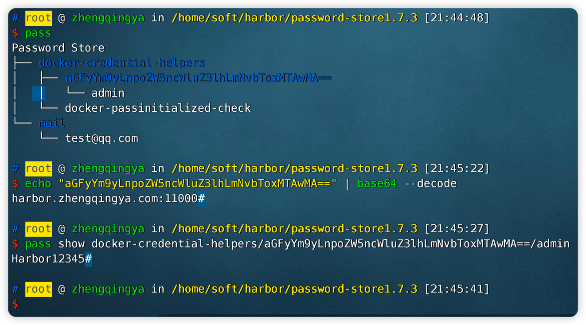

### 6.4 Harbor 私服部署

Harbor 是一个用于存储和分发 Docker 镜像的企业级 Registry 服务器。

#### 部署

```shell
cd /your/install/path
# 下载：https://github.com/goharbor/harbor/releases/
wget https://github.com/goharbor/harbor/releases/download/v2.3.2/harbor-offline-installer-v2.3.2.tgz
tar xvf harbor-offline-installer-v2.3.2.tgz
cd harbor
cp harbor.yml.tmpl harbor.yml
vim harbor.yml   # 修改配置
./install.sh
```

`harbor.yml` 关键配置：

```yml
hostname: harbor.zhengqingya.com
http:
  port: 11000
external_url: http://harbor.zhengqingya.com:11000
harbor_admin_password: Harbor12345
data_volume: /your/path/harbor/data
```

> 如果不需要 https，**注释掉 https 相关配置**，否则安装会报错。

访问 <http://127.0.0.1:11000，登录> `admin/Harbor12345`。新建项目 `test`（推送镜像时需要，否则报 `project test not found`）。

```shell
# harbor安装目录下
docker-compose start   # 运行
docker-compose stop    # 停止
docker-compose rm      # 删除
```

#### docker 推送/拉取镜像

```shell
# 登录harbor
docker login -u admin -p Harbor12345 127.0.0.1:11000
# 通过ip认证需要配置 /etc/docker/daemon.json
# { "insecure-registries": ["192.168.101.90:11000"] }

# 推送
docker tag nginx 127.0.0.1:11000/test/nginx:latest
docker push 127.0.0.1:11000/test/nginx:latest

# 拉取
docker pull 127.0.0.1:11000/test/nginx:latest
```

> 也可通过 hosts 解析 `harbor.zhengqingya.com` 到对应 IP 来登录。

***

## 7. Dockerfile 构建应用镜像

### 7.1 构建 Java 镜像

```dockerfile
# 拉取jdk基础镜像
FROM openjdk:8-jdk-alpine

# 维护者信息
MAINTAINER zhengqingya

# 添加jar包到容器中 -- tips: xx.jar 和 Dockerfile 在同一级
ADD app.jar /home/

# 对外暴漏的端口号
# [注：EXPOSE指令只是声明容器运行时提供的服务端口，给读者看有哪些端口，在运行时只会开启程序自身的端口！！]
EXPOSE 80

# 运行 -- 每个Dockerfile只能有一条CMD命令，以exec格式可实现优雅停止容器服务
CMD ["java", "-jar", "/home/app.jar"]
```

构建与运行：

```shell
# -f：指定Dockerfile文件路径
# -t：镜像命名
# --no-cache：构建镜像时不使用缓存
# 最后的 "."：构建上下文路径，将此路径下所有文件打包上传给Docker引擎
docker build -f Dockerfile -t "registry.cn-hangzhou.aliyuncs.com/zhengqingya/demo:dev" . --no-cache

docker run -d -p 80:80 --name app registry.cn-hangzhou.aliyuncs.com/zhengqingya/demo:dev
docker exec -it app /bin/sh
```

### 7.2 构建 Vue 镜像

```dockerfile
# 拉取nginx基础镜像
FROM nginx:1.21.1

# 维护者信息
MAINTAINER zhengqingya

# 将dist文件中的内容复制到 /usr/share/nginx/html/
COPY dist/  /usr/share/nginx/html/
# 用本地配置文件来替换nginx镜像里的默认配置
COPY Docker/nginx/nginx.conf /etc/nginx/nginx.conf

# 对外暴漏的端口号
EXPOSE 80

# 启动nginx容器
CMD ["nginx", "-g", "daemon off;"]
```

`.dockerignore`（提升构建速度）：

```
node_modules
```

`nginx.conf`（支持 Vue 单页应用路由刷新）：

```nginx
user  nginx;
worker_processes  1;

error_log  /var/log/nginx/error.log warn;
pid        /var/run/nginx.pid;

events {
    worker_connections  1024;
}

http {
    include       /etc/nginx/mime.types;
    default_type  application/octet-stream;

    log_format  main  '$remote_addr - $remote_user [$time_local] "$request" '
                      '$status $body_bytes_sent "$http_referer" '
                      '"$http_user_agent" "$http_x_forwarded_for"';
    access_log  /var/log/nginx/access.log  main;
    sendfile        on;
    keepalive_timeout  65;

    server {
        listen       80;
        server_name  localhost;

        location / {
            root   /usr/share/nginx/html;
            index  index.html index.htm;
            try_files $uri $uri/ /index.html;   # 关键：解决路由刷新404
        }

        error_page   500 502 503 504  /50x.html;
        location = /50x.html {
            root   /usr/share/nginx/html;
        }
    }
}
```

构建与运行：

```shell
docker build -f ./Docker/Dockerfile -t "registry.cn-hangzhou.aliyuncs.com/zhengqing/small-tools-web:prod" . --no-cache

docker run -d --name small-tools-web -p 80:80 --restart=always registry.cn-hangzhou.aliyuncs.com/zhengqing/small-tools-web:prod
```

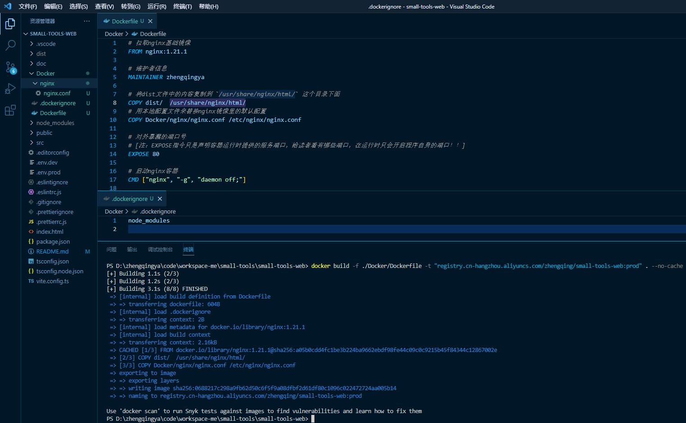

### 7.3 ARG、ENV、CMD 行为说明

- `ARG` 参数仅在镜像构建期间可用
- `ENV` 变量在构建期间和容器中都可用
- `CMD` 在容器启动时执行，其中的 `ARG` 变量不再可用，若需要动态变量值应使用 `ENV`

如果 `CMD` 中的 `ENV` 又引用了另外一个 `ENV`，那么 `JAVA_OPTS` 的值将不能动态获取：

```dockerfile
ENV JAVA_OPTS
ENV RUN_CMD "java -jar ${JAVA_OPTS} app.jar"
CMD ["sh", "-c", "echo \"****** 运行命令：${RUN_CMD}\"   &   ${RUN_CMD}"]
```

让 `JAVA_OPTS` 变量正常动态获取，修改为：

```dockerfile
CMD ["sh", "-c", "echo \"****** 运行命令：java -jar ${JAVA_OPTS} app.jar\"   &   java -jar ${JAVA_OPTS} app.jar"]
```

***

## 8. Docker Compose

对 Docker 容器集群的快速编排，通过 YAML 文件配置创建和运行多容器服务。

### 8.1 常用命令

```shell
# 构建镜像
docker-compose build
docker-compose build --no-cache    # 不使用缓存
# 校验文件格式
docker-compose -f docker-compose.yml config
# 运行服务
docker-compose up -d
# 启动/停止服务
docker-compose start/stop 服务名
docker-compose down                # 停止并删除
# 查看日志
docker logs -f 容器ID
# 查看镜像
docker-compose images
# 拉取镜像
docker-compose pull 镜像名
```

### 8.2 示例：portainer

```yml
version: '3'
services:
  portainer:
    image: registry.cn-hangzhou.aliyuncs.com/zhengqing/portainer:1.24.1
    container_name: portainer
    restart: always
    volumes:
      - "/var/run/docker.sock:/var/run/docker.sock"
      - "./portainer/data:/data"
    environment:
      TZ: Asia/Shanghai
      LANG: en_US.UTF-8
    ports:
      - "9000:9000"
```

```shell
# -p：项目名称  -f：指定yml文件路径  -d：后台启动
docker-compose -f docker-compose-portainer.yml -p portainer up -d
```

### 8.3 自动识别主机 IP

在 Windows 或 Mac 上运行 Docker，可以使用特殊 DNS 名称 `host.docker.internal` 访问主机。

```yml
version: '3'
services:
  kafka:
    image: registry.cn-hangzhou.aliyuncs.com/zhengqing/kafka:3.4.1
    container_name: kafka
    environment:
      ALLOW_PLAINTEXT_LISTENER: yes
      KAFKA_CFG_ZOOKEEPER_CONNECT: zookepper:2181
      KAFKA_CFG_ADVERTISED_LISTENERS: PLAINTEXT://host.docker.internal:9092
    ports:
      - "9092:9092"
```

### 8.4 锚点和别名（通用配置复用）

通过 YAML 的锚点和别名功能，在多个服务中共享通用配置。

```yml
version: '3'

# 定义通用配置
x-common-config: &common-config
  restart: unless-stopped
  volumes:
    - "./nginx/conf/nginx.conf:/etc/nginx/nginx.conf"
    - "./nginx/conf/conf.d/default.conf:/etc/nginx/conf.d/default.conf"
    - "./nginx/html:/usr/share/nginx/html"
    - "./nginx/log:/var/log/nginx"
  environment:
    TZ: Asia/Shanghai
    LANG: en_US.UTF-8

services:
  nginx-1:
    image: registry.cn-hangzhou.aliyuncs.com/zhengqing/nginx:1.21.1
    container_name: nginx-1
    <<: *common-config
    ports:
      - "81:80"

  nginx-2:
    image: registry.cn-hangzhou.aliyuncs.com/zhengqing/nginx:1.21.1
    container_name: nginx-2
    <<: *common-config
    ports:
      - "82:80"
```

***

## 9. 容器网络

### 9.1 创建网络

```shell
docker network create zhengqingya
```

### 9.2 将容器加入网络

```shell
# 将名为 mysql 的容器加入网络 zhengqingya
docker network connect zhengqingya mysql
```

### 9.3 通过容器名通信

加入同一网络后，容器间可通过容器名直接互连通信，不用写具体 IP。

```shell
# canal容器中通过容器名mysql直接连接
docker run -p 11111:11111 --name canal \
-e spring.datasource.address=mysql:3306 \
--network zhengqingya \
-d registry.cn-hangzhou.aliyuncs.com/zhengqing/canal-server:v1.1.5
```

***

## 10. 容器运维

### 10.1 容器和宿主机文件互传

```shell
# 容器 → 宿主机
docker cp 容器ID/容器名:容器文件路径 宿主机文件路径

# 宿主机 → 容器
docker cp 宿主机文件路径 容器ID/容器名:容器文件路径

# ex:
docker cp mysql:/tmp/all.sql /tmp/all.sql
docker cp /tmp/all.sql mysql:/tmp/all.sql
```

### 10.2 容器中执行宿主机 docker 命令

将 docker 宿主机的 docker 文件和 docker.sock 文件挂载到容器中即可。

```shell
docker run -it -d \
--restart=always -u root \
-v /usr/bin/docker:/usr/bin/docker \
-v /var/run/docker.sock:/var/run/docker.sock \
-v /usr/lib64/libltdl.so.7:/usr/lib/x86_64-linux-gnu/libltdl.so.7 \
镜像名称
```

参数说明：

- `-u root`：以 root 身份运行（避免无权限调用 docker 命令）
- `-v /usr/bin/docker:/usr/bin/docker`：挂载 docker 命令（可用 `which docker` 查看位置）
- `-v /var/run/docker.sock:/var/run/docker.sock`：与 Docker 守护进程通信
- `-v /usr/lib64/libltdl.so.7:...`：挂载 docker 依赖的函数库（CentOS 位置 `/usr/lib64/`，Ubuntu 位置 `/usr/lib/x86_64-linux-gnu/`）

### 10.3 优雅停止容器

`docker stop`：先请求容器进程停止，如果 10 秒后未停止，将强制 kill 该进程。

> `docker stop` 向容器内的根进程（PID1）发送 `SIGTERM` 信号。如果根进程在超时时间内没退出，便发出 `SIGKILL` 信号。

```shell
# 指定超时时间停止容器
docker stop --time=30 容器名
```

Dockerfile 中使用 exec 格式的 CMD 指令可实现优雅停止：

```dockerfile
CMD ["java", "-jar", "/home/demo.jar"]
```

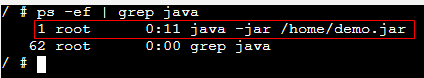

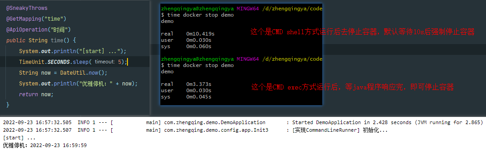

#### 信号说明

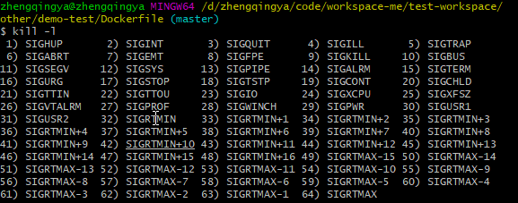

- `1) SIGHUP` 终端断开时发送，守护进程收到后通常重新初始化
- `2) SIGINT` 键入 Ctrl-C 时发送，默认终止进程
- `3) SIGQUIT` 键入 Ctrl-\ 时发送，终止进程并生成核心转储
- `9) SIGKILL` 必杀信号，无法阻塞/忽略/捕获，一击必杀
- `15) SIGTERM` 终止进程的标准信号（kill 默认发送），应设置处理器程序做资源清理
- `20) SIGTSTP` 键入 Ctrl-Z 时发送，停止前台进程组

```shell
# 优雅关闭nginx服务
docker kill --signal=SIGQUIT nginx

# 优雅关闭Apache服务
docker kill --signal=SIGWINCH apache
```

### 10.4 重启策略

- `--restart=no` 默认策略，容器退出时不重启
- `--restart=on-failure` 容器非正常退出时（退出状态非 0）重启
- `--restart=on-failure:3` 非正常退出时重启，最多 3 次
- `--restart=always` 容器退出时总是重启
- `--restart=unless-stopped` 总是重启，但不考虑 Docker 守护进程启动时已停止的容器

```shell
docker run -d -p 9000:9000 --restart=always --name portainer \
-v /var/run/docker.sock:/var/run/docker.sock \
registry.cn-hangzhou.aliyuncs.com/zhengqing/portainer:1.25.0
```

### 10.5 日志驱动

```shell
# 查看docker默认容器日志驱动
docker info|grep 'Logging Driver'
# Logging Driver: json-file
```

#### 推送日志到 logstash

logstash 配置 `logstash.conf`：

```
input {
  gelf {
    use_udp => true
    port_tcp => 12202
  }
}

filter {
    mutate {
        remove_field => ["LOG_MAX_HISTORY_DAY", "LOG_HOME", "APP_NAME"]
        remove_field => ["@version", "_score", "port", "level_value", "tags", "_type", "host"]
    }
}

output {
    stdout { codec => rubydebug }
}

output {
   elasticsearch {
       action => "index"
       hosts  => "http://elasticsearch:9200"
       user => "elastic"
       password => "123456"
       index  => "demo-%{+YYYY.MM.dd}"
       codec  => "json"
   }
}
```

docker 容器配置：

```shell
# 方式一：docker run
docker run -d --name test -p 666:80 \
--log-driver gelf \
--log-opt gelf-address=udp://127.0.0.1:12201 \
--log-opt tag=test \
registry.cn-hangzhou.aliyuncs.com/zhengqing/test:dev
```

```yml
# 方式二：docker-compose.yml
version: '3'
services:
  test:
    image: registry.cn-hangzhou.aliyuncs.com/zhengqing/test:dev
    container_name: test
    ports:
      - "666:80"
    logging:
      driver: gelf
      options:
        gelf-address: udp://127.0.0.1:12201
        tag: test
```

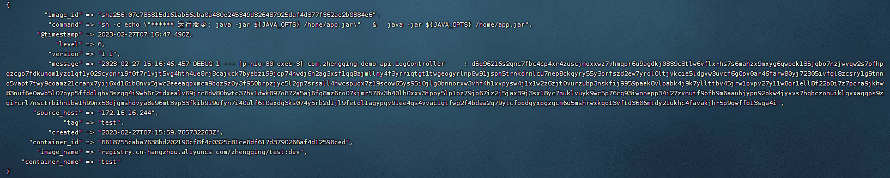

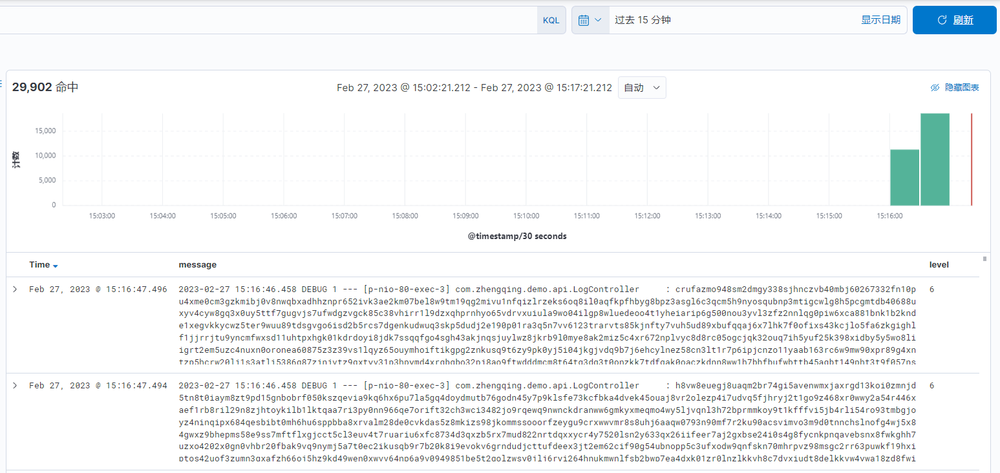

***

## 11. 安全与远程访问

### 11.1 Docker 常见端口

```
2375：未加密的docker socket,远程root无密码访问主机
2376：tls加密套接字,很可能这是您的CI服务器
2377：群集模式套接字,适用于群集管理器
5000：docker注册服务
4789和7946：覆盖网络
```

### 11.2 配置远程连接 2375 端口

> **警告**：2375 端口未加密，存在安全风险，生产环境请配合 TLS 使用（见 11.3）。

修改宿主机配置（三选一）：

```shell
# 法一：修改 docker.service
vim /lib/systemd/system/docker.service
# 在 ExecStart 开头的行末尾添加
ExecStart=/usr/bin/dockerd -H tcp://0.0.0.0:2375 -H unix://var/run/docker.sock

# 法二：修改 daemon.json
vim /etc/docker/daemon.json
# { "hosts": ["tcp://0.0.0.0:2375", "unix:///var/run/docker.sock"] }

# 法三：修改 default/docker
vim /etc/default/docker
# DOCKER_OPTS="-H tcp://0.0.0.0:2375"
```

重启并开放端口：

```shell
systemctl daemon-reload && systemctl restart docker
firewall-cmd --zone=public --add-port=2375/tcp --permanent
```

访问测试：

```shell
docker -H tcp://www.zhengqingya.com:2375 version
docker -H tcp://www.zhengqingya.com:2375 images
```

### 11.3 开启 TLS 和 CA 认证

参考：<https://docs.docker.com/engine/security/protect-access/#create-a-ca-server-and-client-keys-with-openssl>

#### 1. 生成证书

```shell
mkdir -p /home/soft/docker/ca
cd /home/soft/docker/ca

cat> auto-generate-docker-tls-ca.sh <<'EOF'
#!/bin/bash
SERVER="192.168.101.90"          # 服务器外网IP或域名 TODO
PASSWORD="${SERVER}123456"        # 密码
COUNTRY="CN"
STATE="四川省"
CITY="成都市"
ORGANIZATION="科技公司"
ORGANIZATIONAL_UNIT="好好学习"
EMAIL="zhengqingya@it.com"

# 生成CA密钥
openssl genrsa -aes256 -passout pass:$PASSWORD -out ca-key.pem 2048
# 生成CA证书
openssl req -new -x509 -passin "pass:$PASSWORD" -days 3650 -key ca-key.pem -sha256 -out ca.pem -subj "/C=$COUNTRY/ST=$STATE/L=$CITY/O=$ORGANIZATION/OU=$ORGANIZATIONAL_UNIT/CN=$SERVER/emailAddress=$EMAIL"

# 生成服务端密钥和证书
openssl genrsa -out server-key.pem 2048
openssl req -subj "/CN=$SERVER" -new -key server-key.pem -out server-req.csr
openssl x509 -req -days 3650 -in server-req.csr -CA ca.pem -CAkey ca-key.pem -passin "pass:$PASSWORD" -CAcreateserial -out server-cert.pem

# 生成客户端密钥和证书
openssl genrsa -out key.pem 2048
openssl req -subj '/CN=client' -new -key key.pem -out client-req.csr
sh -c 'echo "extendedKeyUsage=clientAuth" >> extfile.cnf'
openssl x509 -req -days 3650 -in client-req.csr -CA ca.pem -CAkey ca-key.pem -passin "pass:$PASSWORD" -CAcreateserial -out cert.pem -extfile extfile.cnf

# 更改权限
chmod 0400 ca-key.pem server-key.pem key.pem
chmod 0444 ca.pem server-cert.pem cert.pem
EOF

sh auto-generate-docker-tls-ca.sh
```

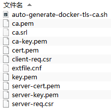

#### 2. 开启远程访问与配置认证

```shell
vim /lib/systemd/system/docker.service
# 在 ExecStart=/usr/bin/dockerd 这行最后追加：
--tlsverify --tlscacert=/home/soft/docker/ca/ca.pem --tlscert=/home/soft/docker/ca/server-cert.pem --tlskey=/home/soft/docker/ca/server-key.pem -H tcp://0.0.0.0:2375 -H unix:///var/run/docker.sock

# 防火墙开放2375端口
firewall-cmd --zone=public --add-port=2375/tcp --permanent
firewall-cmd --reload

systemctl daemon-reload && systemctl restart docker

# 测试（需带上密钥和证书）
curl https://192.168.101.90:2375/info --cert ./cert.pem --key ./key.pem --cacert ./ca.pem
```

#### 3. 本地测试

```shell
# 将 ca.pem cert.pem key.pem 拷贝到本地
tar -cvf docker-ca.tar ca.pem cert.pem key.pem

# 测试（windows上用 git bash）
curl https://192.168.101.90:2375/version --cert ./cert.pem --key ./key.pem --cacert ./ca.pem
```

#### 4. IDEA 配置

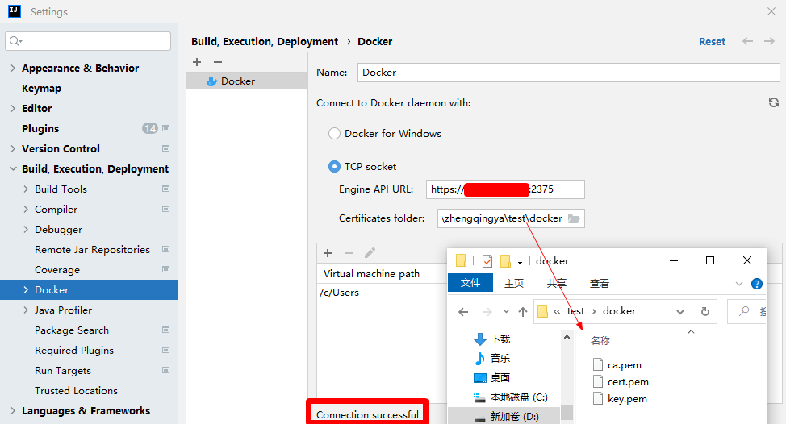

***

## 12. 可视化管理工具

### 12.1 Portainer

```shell
docker run -d -p 9000:9000 --restart=always --name portainer \
-v /var/run/docker.sock:/var/run/docker.sock \
registry.cn-hangzhou.aliyuncs.com/zhengqing/portainer:1.24.1
```

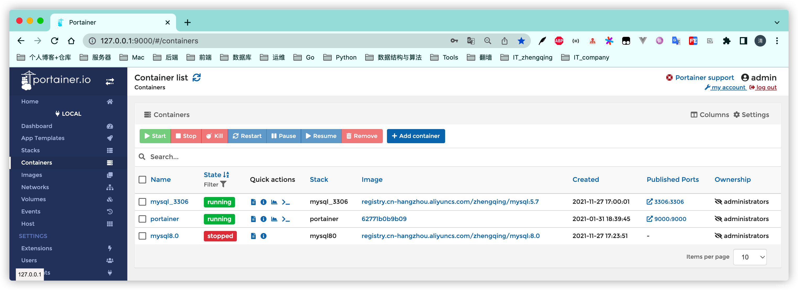

### 12.2 IDEA 中通过 Dockerfile 部署服务

1. 安装 docker 插件
2. 配置 docker 远程访问（见 [11. 安全与远程访问](#11-安全与远程访问)）
3. Dockerfile 配置运行

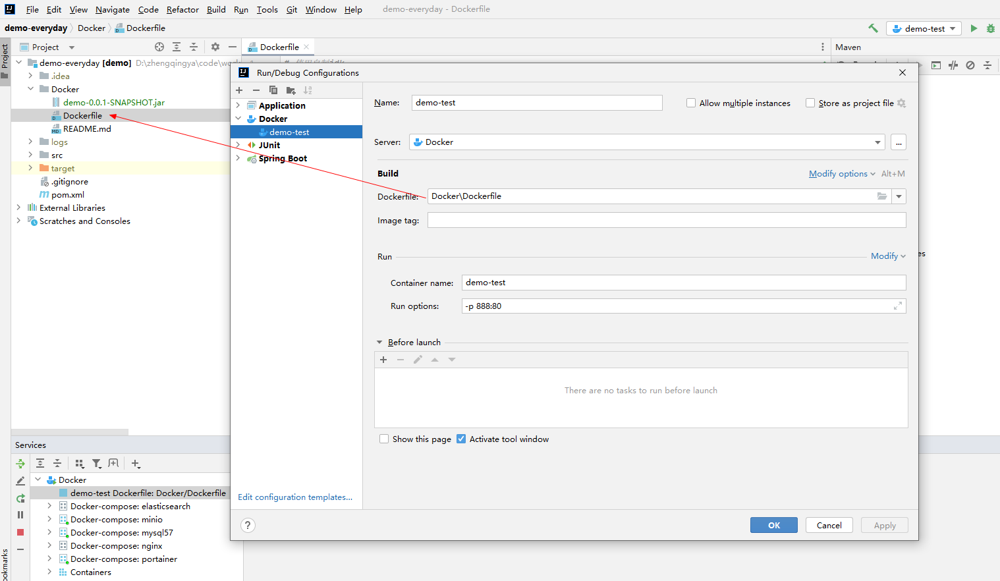

***

## 13. Docker Swarm

- **Docker Compose**：在单机上创建多个容器
- **Docker Swarm**：在多服务器上创建容器集群服务，更有利于微服务部署

### 13.1 环境准备

| 机器             | 说明    |
| -------------- | ----- |
| 192.168.101.90 | node1 |
| 192.168.101.22 | node2 |

需在各节点安装 Docker 并配置远程连接 2375 端口（Swarm 通过监听 2375 端口通信）。

防火墙开放以下端口或关闭防火墙：

- TCP 端口 2377，用于集群管理通信
- TCP 和 UDP 端口 7946，用于节点之间通信
- UDP 端口 4789，用于覆盖网络

### 13.2 集群部署

#### 初始化 Swarm

```shell
docker pull swarm
# --advertise-addr 参数表示其它swarm中的worker节点使用此ip地址与manager联系
docker swarm init --advertise-addr 192.168.101.90

# 查看管理节点的 token
docker swarm join-token manager
# 查看工作节点的 token
docker swarm join-token worker
```

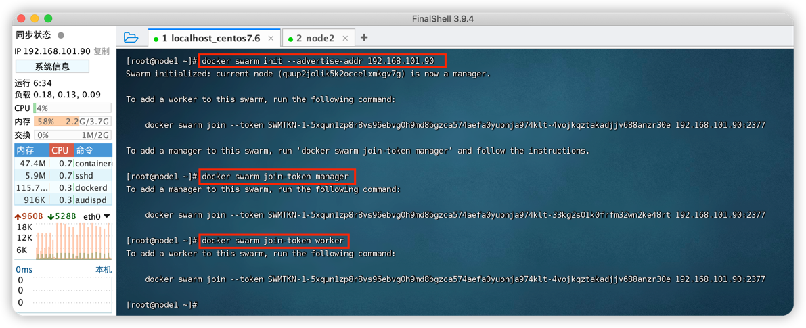

#### 添加集群节点

```shell
docker swarm join --token SWMTKN-1-xxx 192.168.101.90:2377
```

#### 查看集群节点

```shell
# AVAILABILITY列：Active(可分配) | Pause(不分配新任务) | Drain(迁移现有任务)
# MANAGER STATUS列：无值(工作节点) | Leader(主管理器) | Reachable(参与Raft共识) | Unavailable(不可用)
docker node ls
docker node inspect 节点名称|节点ID
```

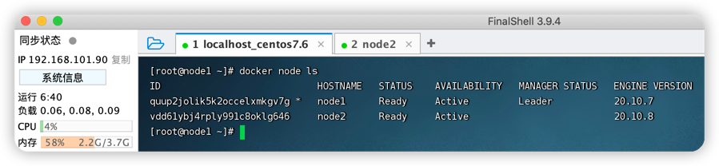

#### 删除节点

```shell
# 删除前先将该节点 AVAILABILITY 改为 Drain，将服务迁移到其他可用节点
docker node update --availability drain 节点名称|节点ID

# Manager节点：先降级再离开
docker node demote 节点名称|节点ID
docker swarm leave          # 在已降级的节点中执行
docker node rm 节点名称|节点ID

# Worker节点：直接离开
docker swarm leave
docker node rm 节点名称|节点ID
```

### 13.3 Swarm 实战

#### 创建服务

```shell
# --replicas：指定实例数  --name：服务名称
docker service create --replicas 2 --name mynginx -p 80:80 nginx

# 查看所有服务
docker service ls
# 查看服务详情
docker service inspect mynginx
# 查看服务运行在哪些节点上
docker service ps mynginx

# 测试删除其中1个nginx容器后，会自动创建1个新的来保证2个实例
docker rm -f 容器ID/容器名
```

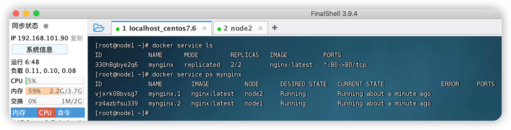

访问 `集群任意IP:80`

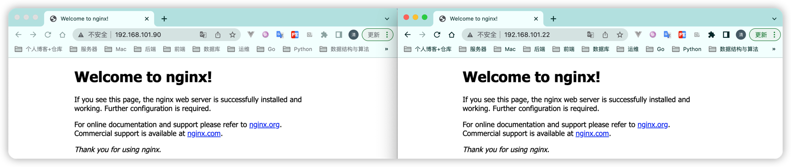

#### 弹性服务（动态扩缩容）

```shell
# 扩容到5个
docker service scale mynginx=5
# 缩容到3个
docker service update --replicas 3 mynginx
```

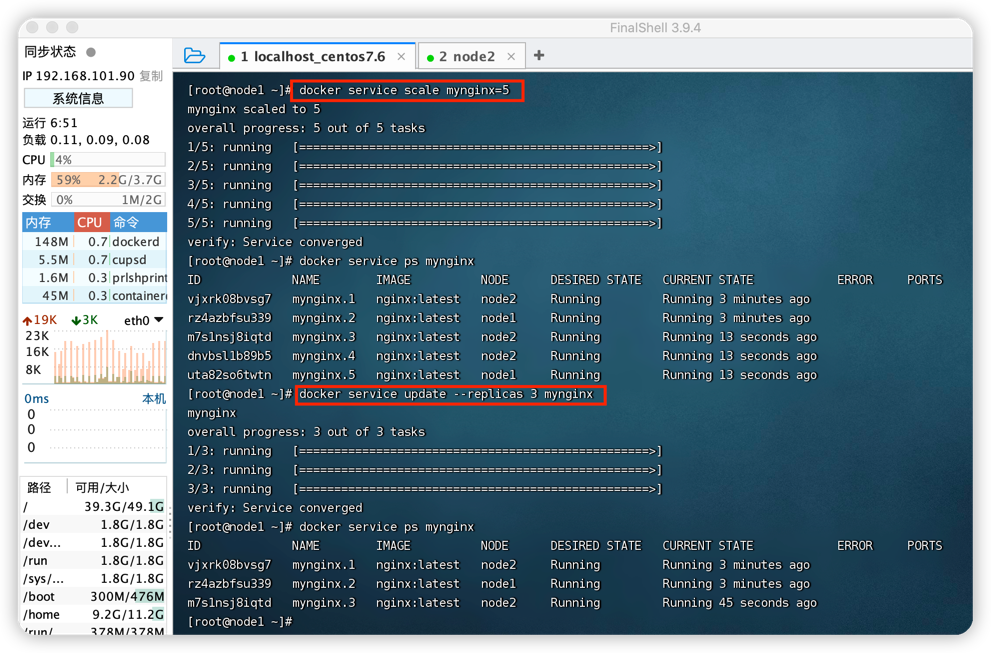

#### 删除服务

```shell
docker service rm mynginx
```

#### 滚动更新与版本回滚

```shell
# 创建5个副本，每次更新2个，间隔10s，20%失败执行回滚
docker service create --replicas 5 --name redis \
    --update-delay 10s \
    --update-parallelism 2 \
    --update-failure-action continue \
    --rollback-monitor 20s \
    --rollback-parallelism 2 \
    --rollback-max-failure-ratio 0.2 \
    redis:5
```

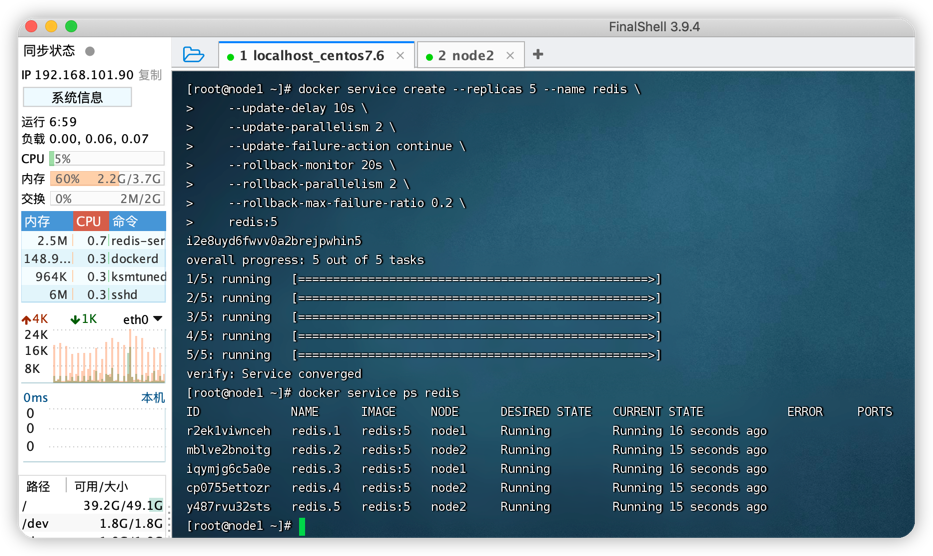

```shell
# 滚动更新
docker service update --image redis:6 redis

# 回滚（只能回滚到上一次操作的状态，不能连续回滚）
docker service update --rollback redis
```

### 13.4 Swarm 常用命令

```shell
# === 集群 ===
docker swarm init                      # 初始化集群
docker swarm join-token worker         # 查看工作节点token
docker swarm join-token manager        # 查看管理节点token
docker swarm join                      # 加入集群
docker swarm leave                     # 离开集群

# === 节点 ===
docker node ls                         # 查看所有节点
docker node ps                         # 查看当前节点所有任务
docker node rm 节点名称|节点ID          # 删除节点（-f强制）
docker node inspect 节点名称|节点ID     # 查看节点详情
docker node demote 节点名称|节点ID      # 管理节点 → 工作节点
docker node promote 节点名称|节点ID      # 工作节点 → 管理节点
docker node update 节点名称|节点ID      # 更新节点

# === 服务 ===
docker service create                  # 创建服务
docker service ls                      # 查看所有服务
docker service inspect 服务名称|服务ID  # 查看服务详情
docker service logs 服务名称|服务ID     # 查看服务日志
docker service rm 服务名称|服务ID       # 删除服务（-f强制）
docker service scale 服务名称=n         # 设置服务数量
docker service update 服务名称|服务ID   # 更新服务
```

***

## 14. 自动更新镜像 — Watchtower

### 自动清除旧镜像

```shell
docker run -d \
    --name watchtower \
    --restart unless-stopped \
    -v /var/run/docker.sock:/var/run/docker.sock \
    containrrr/watchtower \
    --cleanup    # -c 简写
```

### 选择性自动更新

```shell
# 只自动更新 nginx 和 redis 容器
docker run -d \
    --name watchtower \
    --restart unless-stopped \
    -v /var/run/docker.sock:/var/run/docker.sock \
    containrrr/watchtower -c \
    nginx redis
```

通过列表文件管理：

```shell
cd /zhengqingya/soft/docker
echo 'small-tools
code-api' > watchtower.list

docker run -d \
    --name watchtower \
    --restart unless-stopped \
    -v /var/run/docker.sock:/var/run/docker.sock \
    containrrr/watchtower -c \
    $(cat ~/.watchtower.list)
```

### 设置更新检查频率

```shell
# --interval, -i：设置时间间隔（秒），如每小时检查一次
docker run -d \
    --name watchtower \
    --restart unless-stopped \
    -v /var/run/docker.sock:/var/run/docker.sock \
    containrrr/watchtower -c \
    --interval 3600

# --schedule, -s：6字段Cron表达式，如每天凌晨2点
docker run -d \
    --name watchtower \
    --restart unless-stopped \
    -v /var/run/docker.sock:/var/run/docker.sock \
    containrrr/watchtower -c \
    --schedule "0 2 * * * *"
```

### 最终实战命令

```shell
docker run -d \
    --name watchtower \
    --restart unless-stopped \
    -v /var/run/docker.sock:/var/run/docker.sock \
    containrrr/watchtower -c \
    $(cat $PWD/watchtower.list) \
    -i 30
```

***

## 15. 问题排查与常见问题

### 15.1 容器内无法访问外网

> tips: 由于环境不同，解决方法也自然不同，下面是多种尝试方案。

#### 法一：重建网络 docker0

```shell
sudo service docker stop
sudo pkill docker
sudo iptables -t nat -F
sudo ifconfig docker0 down
sudo brctl delbr docker0
sudo service docker start
```

#### 法二：开启宿主机 ipv4 转发

> 针对 `WARNING: IPv4 forwarding is disabled. Networking will not work.`

```shell
echo "net.ipv4.ip_forward=1" >> /etc/sysctl.conf
systemctl restart network
sysctl net.ipv4.ip_forward   # 1表示开启
systemctl restart docker
```

#### 法三：使用 --net=host 宿主机网络

```shell
docker run --net=host --rm alpine ping -c 5 baidu.com
```

#### 法四：关闭 SELinux

```shell
getenforce            # 查看状态
setenforce 0          # 临时关闭
# 永久关闭：vim /etc/selinux/config 将 SELINUX=enforcing 改为 disabled
reboot
```

#### 法五：修改 br-netfilter 配置

```shell
echo "net.bridge.bridge-nf-call-ip6tables = 1" >> /etc/sysctl.conf
echo "net.bridge.bridge-nf-call-iptables = 1" >> /etc/sysctl.conf
echo "net.bridge.bridge-nf-call-arptables = 1" >> /etc/sysctl.conf
service docker restart
```

#### 法六：清理 docker 网络数据

```shell
rm -rf /var/lib/docker/network/*
systemctl restart docker
```

#### 法七：修改 DNS

```shell
# 修改宿主机DNS
echo nameserver 114.114.114.114 > /etc/resolv.conf
docker run --rm alpine ping -c 5 baidu.com
```

修改容器内部 DNS（容器内 DNS 与宿主机不一致时）：

```shell
docker exec -it 容器ID/容器名 /bin/bash
cat /etc/resolv.conf
# 注释 options 行
echo "nameserver 127.0.0.11" > /etc/resolv.conf
ping baidu.com
```

#### 法八：tcpdump 抓包分析

```shell
docker run --rm alpine ping -c 50 baidu.com
yum install tcpdump
tcpdump -i docker0 icmp
# 发现有request包但无response，可能是被防火墙阻断
```

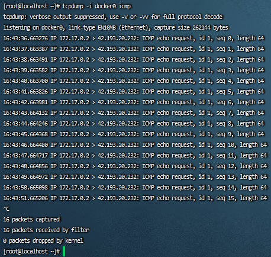

#### 法九：防火墙开启 IP 伪装

```shell
firewall-cmd --add-masquerade --permanent
firewall-cmd --permanent --zone=trusted --add-interface=docker0
firewall-cmd --reload
```

#### 临时测试容器内 ping

```shell
docker run --rm alpine ping -c 5 baidu.com
```

### 15.2 容器日志占用磁盘空间过大

```shell
# 查询占用磁盘较大的文件-升序
du -d1 -h /var/lib/docker/containers | sort -h
```

#### 控制容器日志大小

##### 法一：运行时控制

docker：

```shell
# max-size：容器日志最大100M
# max-file：最大日志数3个（ ex: *-json.log, *-json.log.1, *-json.log.2 ）
docker run -it --log-opt max-size=100m --log-opt max-file=3 redis
```

docker-compose：

```yml
version: '3'

services:
  test:
    image: xxx
    # 日志
    logging:
      driver: "json-file"   # 默认的文件日志驱动
      options:
        max-size: "100m"    # 单个日志文件大小为100m
        max-file: "3"       # 最多3个日志文件
```

##### 法二：全局配置

> 温馨小提示：新容器生效

```shell
# 创建或修改 daemon.json 文件
{
    "log-driver": "json-file",
    "log-opts": {
        "max-size":"100m",
        "max-file":"3"
    }
}

# 重启docker
systemctl daemon-reload
systemctl restart docker
```

#### 清理容器日志脚本

> 以下脚本可保存为 .sh 文件执行，需 root 权限。

##### 查询容器日志大小

```shell
#!/bin/bash
set -eu
echo "================== ↓↓↓↓↓↓ 查询docker容器日志大小 ↓↓↓↓↓↓ ================"
logs=$(find /var/lib/docker/containers/ -name '*-json.log*')
for log in $logs
do
    ls -lh $log
done
echo "===================================================================="
```

##### 清理容器日志

```shell
#!/bin/bash
set -eu
echo "================== ↓↓↓↓↓↓ 清理docker容器日志 ↓↓↓↓↓↓ =================="
logs=$(find /var/lib/docker/containers/ -name '*-json.log*')
for log in $logs
do
    echo "clean log: $log"
    cat /dev/null > $log
done
echo "===================================================================="
```

***
### 15.3 overlay2 占用空间太大

> **千万不要直接删除**！！！只能删除无用镜像或相关日志。不懂操作建议先存快照。

```shell
# 查看 docker 所占硬盘大小
docker system df

# 自动清理空间（停止的容器、未使用的卷、悬空镜像）
docker system prune -a

# 清理未使用的数据卷
docker volume prune
```

overlay2 文件管理说明：

- `lower-id`：记录镜像层顶层 ID（lowerdir）
- `upper`（diff）：可读写层（upperdir）
- `merged`：联合挂载点
- `work`：OverlayFS 内部文件

### 15.4 根据 overlay2 目录名查找对应容器

```shell
# 依次输出：进程pid、容器ID、容器名、存储work路径
docker ps -q | xargs docker inspect --format '{{.State.Pid}}, {{.Id}}, {{.Name}}, {{.GraphDriver.Data.WorkDir}}' | grep 目录名
```

### 15.5 常见问题

#### bash: vi: command not found

```shell
apt-get update
apt-get install vim
```

#### bash: ping: command not found

```shell
apt-get update
apt-get install iputils-ping
```

***

## 16. Docker Desktop

<https://docs.docker.com/desktop>

Docker 桌面应用，适用于 Windows 和 Mac。
